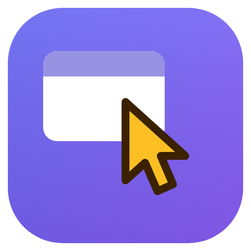

# TabShare Remote Control

A Chrome extension that lets you share **one tab, or a whole browser
window**, with a trusted friend — like a tiny AnyDesk/TeamViewer scoped to
Chrome — except there's no dedicated server and no account setup. The
video/control stream goes directly between your two Chromes over WebRTC; a
free public signaling broker ([PeerJS](https://peerjs.com)'s `0.peerjs.com`)
is used only to introduce the two of you — you send one short code, and the
connection completes automatically.

**Read [SETUP.md](SETUP.md) first** — it's short, no cloud accounts needed.

## How it works

1. **You** click the extension icon and pick a mode:
   - **One tab** — shares exactly the tab that was active when you opened
     the popup.
   - **Whole window** — scopes sharing to a chosen window. Switching which
     tab is shared isn't automatic, though: Chrome requires a fresh,
     tab-specific user gesture before it'll authorize capturing a tab's
     video — no permission (not even the broad `<all_urls>`) substitutes
     for that; it's a deliberate security boundary, not a bug I could code
     around. So to switch tabs, make the new one active and click the
     toolbar icon again — the popup detects you're already sharing that
     window and shows a **"Continue sharing with this tab"** button. That
     click supplies the gesture; capture and control retarget to it live,
     no restart, no new code. Your friend won't see Chrome's own tab strip/
     address bar either way (extensions can't capture or control that, only
     page content) — just an instant content swap when you switch.

   Either way, this captures the tab's video via `chrome.tabCapture` and
   attaches `chrome.debugger` to it — that's what lets injected clicks/
   keystrokes register as *real* input, the same mechanism DevTools/
   Puppeteer use. (This is why you'll see a "being debugged" bar while
   sharing — it's Chrome's own UI, not a bug. In window mode it reappears
   each time you switch tabs, since the debugger has to reattach.)
2. Your Chrome registers a random session ID with PeerJS's public broker and
   shows it to you as a short code. You send that to your friend however you
   normally talk to them.
3. **Your friend** clicks their extension icon → *Join a friend's share* →
   pastes your code. Their Chrome connects to your ID via the same broker;
   the WebRTC offer/answer/ICE exchange happens automatically from there.
   You click **Allow** on your sharing page to let them in.
4. Once connected, video flows **directly peer-to-peer** to your friend, and
   their mouse/keyboard events flow directly back to you over a data
   connection.
5. Your Chrome receives those events and replays them on the real tab via
   `chrome.debugger`'s `Input.dispatch*` commands.

Your friend opens the viewer as a **normal new tab**
(`chrome-extension://.../viewer.html`) — it's not tied to any specific site
they were on, so they can open it from any tab, any time, on their own
Chrome.

## Files

| File | Runs where | Does |
|---|---|---|
| `manifest.json` | — | Permissions and the pinned extension ID |
| `host.html` / `host.js` | popup | Pick a tab or window to share, or open the viewer |
| `host-panel.html` / `host-panel.js` | new tab (host) | Shows your code, status, Stop button |
| `background.js` | service worker | Owns `chrome.debugger` + the offscreen document lifecycle |
| `offscreen.html` / `offscreen.js` | hidden offscreen doc (host) | Tab capture, PeerJS connection |
| `viewer.html` / `viewer.js` | new tab (friend) | Join UI, video playback, input capture |
| `vendor/peerjs.min.js` | shared | Bundled PeerJS client (can't load remote scripts in an extension) |
| `shared/rtc-config.js` | shared | STUN server list (+ your optional TURN), passed into PeerJS's config |
| `settings.html` / `settings.js` | options page | Add and test your own TURN server for strict networks |
| `shared/codec-prefs.js` | shared | Prefers bandwidth-efficient video codecs (VP9/AV1) |
| `shared/manual-link.js` | shared | Serverless invite/reply code exchange (fallback when the broker is unreachable) |

## Safety & control

- **You approve every new viewer.** When someone joins with your code, the
  sharing page asks **Allow / Deny** (and the toolbar icon shows a badge).
  Nobody gets in just by having the code. Once allowed, a friend whose
  connection blips is let back in automatically — no repeated prompts.
- **View-only switch.** Untick "Allow them to control this tab" at any time;
  enforced on your side, so a modified viewer can't bypass it.
- **Disconnect friend** button — drops them and forgets their approval.

## Works without the connection service

If PeerJS's broker is down or blocked, use **Connect manually** on the
sharing page: you send an invite code, your friend pastes it into the
viewer's **Manual** tab and sends back a reply code. That's all — the
connection is made with no server at all. (Manual sessions can't
reconnect by themselves; create a new invite if one drops.)

## Stability features

- **Auto-reconnect.** If the link drops (Wi-Fi blip, mobile signal loss,
  laptop sleep), the viewer notices within ~10 seconds via a heartbeat and
  rejoins the same code with backoff — no new code needed. The host accepts
  the rejoin in place of the stale connection.
- **Broker recovery.** If the host loses contact with the PeerJS broker, it
  re-registers the *same* code automatically. A session already in progress
  isn't affected (video and input are peer-to-peer).
- **Multiple STUN providers** (Google, Cloudflare, Xiaomi), so one being
  blocked in a region — e.g. Google in mainland China — doesn't break
  connection setup.
- **Slow-link friendly.** Video is tagged as screen content, so under low
  bandwidth it drops frame rate rather than sharpness; mouse moves are
  throttled and skipped when the link is congested, so clicks and keys
  aren't delayed behind them.
- **Quality picker** in the viewer — Data saver (~0.2 Mbps, no sound),
  Low, **Balanced (default, ~1 Mbps)**, High, Unlimited.

## Low data use

- **Video pauses when nobody's watching.** If the friend switches away from
  the viewer tab or minimizes it, the host stops sending video and sound
  entirely, and resumes instantly when they come back.
- **Efficient codecs.** Prefers VP9, then AV1, then H.264, over Chrome's
  default VP8 — typically noticeably less data for the same sharpness on
  pages and text (`shared/codec-prefs.js`).
- **Static pages cost almost nothing** — the encoder only sends what changes.
- **Sound toggle** in the viewer; sound off saves a little more.
- **Lean input:** mouse moves are capped at ~30/second, skipped when
  unchanged, and use compact coordinates.
- **Data used** counter in the viewer's top bar.
- **Speed limit** (Connection settings): cap video + sound at 100 kbps –
  5 Mbps. Works for either side — the lower of the two people's limits
  wins — and applies instantly, even mid-session. Under tight limits, sound
  gets a small share (or is dropped below ~120 kbps) and the picture lowers
  its frame rate to stay readable.
- **Live connection info** in the viewer: Direct or Relayed, latency, frame
  rate, bitrate and packet loss.
- **Optional TURN server** in Connection settings, with a Test button.

## Honest limitations

- **Your friend can never control Chrome's own UI** — the tab strip,
  address bar, extensions toolbar, New Tab button. That's a hard platform
  limit for any Chrome extension, not something this could be built around;
  in window mode they can only interact with whatever page content is
  currently showing.
- **Switching tabs in window mode takes one click from you, not zero.**
  Chrome won't let capture silently follow you to a new tab — see "How it
  works" above. This keeps the extension on the narrow `activeTab`
  permission rather than needing `<all_urls>`.
- **No built-in relay.** The free public TURN relay this used to rely on
  (Open Relay, `openrelay.metered.ca`) has shut down, and no free relay
  works without an account. Very restrictive networks (strict corporate
  firewalls, carrier-grade NAT on some mobile networks, national firewalls)
  may not connect directly — add a free-tier TURN account under
  **Connection settings** (only one of you needs it).
- **Relies on a third party's free public server** (PeerJS's `0.peerjs.com`)
  to carry the connection *handshake* — your session ID and the WebRTC
  offer/answer/ICE metadata pass through it briefly. The video/keystrokes
  themselves never do; those go directly between your two Chromes. If that
  public server is ever down or rate-limited, sessions can't connect until
  it's back (there's no fallback broker configured).
- Session codes are random and effectively unguessable, but the broker is a
  shared public namespace — treat the code like a temporary password, don't
  post it somewhere public.
- Keyboard forwarding covers normal typing, shortcuts, and modifier combos
  well, but things like IME input for non-Latin scripts, drag-and-drop, and
  file-picker dialogs won't work — those need real OS-level events this
  approach can't produce.
- Built for one friend at a time on one tab at a time — not a multi-viewer
  broadcast tool.
